# GhostLock SM-G990B

Temporary root for the locked-bootloader Samsung Galaxy S21 FE 5G on one exact firmware build.

| Target | Value |
| --- | --- |
| Device | `SM-G990B` / `r9q` |
| Firmware | `G990BXXSLIZH2` |
| Android | 16 / One UI 8 |
| Kernel | `5.4.289-qgki-32192773-abG990BXXSLIZH2` |
| Result | uid 0 daemon, SELinux permissive, no persistence |
| Hardware status | two consecutive clean-boot runs, exit status 0 |

This does not unlock the bootloader. Root disappears after reboot.



> [!CAUTION]
> This build is firmware-specific. A wrong kernel can panic or corrupt memory. Force reboot before every attempt, wait for `sys.boot_completed=1`, and never retry on the same boot after the PI writer ran.

## Run

The checked-in prebuilt binaries match the source in this repository.

```sh
./scripts/run.sh YOUR_ADB_SERIAL
./scripts/verify-root.sh YOUR_ADB_SERIAL
```

`run.sh` forces a clean reboot, pushes both binaries, and runs one attempt. Pass another ADB serial or set `ADB_SERIAL` for a different owned test unit.

Expected verification:

```text
uid=0(root) gid=0(root) groups=0(root) context=u:r:kernel:s0
root
Permissive
```

Prebuilt SHA-256:

```text
65ca8fc1729c8411a212d227a742c73d28fdcc45dd7c1faca35e721c869cd352  prebuilt/ghostlock-sm-g990b
7272fcefdee8884a137c6ea01e59a58da9ac295a91c6963c36fc395971855197  prebuilt/ghostlock-root
```

## Build

Requires Android NDK r27 or newer.

```sh
ANDROID_NDK_HOME=/opt/android-sdk/ndk/27.1.12297006 make
```

Outputs:

```text
build/ghostlock-sm-g990b
build/ghostlock-root
```

The legacy AArch32 overlay helper is optional:

```sh
ANDROID_NDK_HOME=/opt/android-sdk/ndk/27.1.12297006 make legacy
```

## Chain

| Stage | What happens |
| --- | --- |
| Address discovery | tracefs leaks the KASLR slide; KernelSnitch locates an `mm_struct` slab |
| Controlled reclaim | all 34 slab objects are held and released; io_uring orders 3-9 plus skb data carry the fake layout |
| Waiter overlay | a `pselect6` copy-out COW fault holds the kernel stack frame while `sched_setattr` starts the PI walk |
| Kernel write | `rb_erase` redirects `ashmem_misc.fops` to a fake table |
| Kernel R/W | configfs callbacks provide arbitrary R/W; a marked skb oracle moves the exact page into kmalloc-1k pipe buffers |
| Root | pipe physrw disables SELinux and inserts a CFI-valid UMH work item into `system_unbound_wq` |
| Verification | the uid-0 daemon runs `id`, then the exploit restores modified kernel globals |

The rendered diagram above comes from [`docs/exploit-chain.html`](docs/exploit-chain.html). The shorter technical explanation is in [`docs/TECHNICAL.md`](docs/TECHNICAL.md).

## Repository layout

```text
src/          exploit and root-helper source
prebuilt/     hardware-tested binaries
docs/         chain diagram and technical notes
scripts/      clean-boot runner and root check
```

## Authorship and AI disclosure

This port was developed across three model sessions:

- **GLM-5.3** (Z.ai) and **Claude Opus 4.6** (Anthropic) did the foundational reverse engineering, early porting, and allocator/stack-route debugging.
- **GPT-5.6 Sol** (OpenAI) resumed from that handover and completed the working COW overlay, deterministic reclaim, fake FOPS/configfs R/W, pipe physrw, UMH root chain, standalone packaging, and 5.4 KernelSU work.

The repository owner supplied the phone, firmware, authorization, and the few required physical interactions. This notice records the substantial AI authorship transparently for EU-facing distribution; it does not assign copyright to any model.

## Credits

- [NebuSec / CyberMeowfia](https://github.com/NebuSec/CyberMeowfia) for the original GhostLock exploit.
- [GhostLock Sabrina](https://github.com/k-o-n-t-o-r/ghostlock-sabrina) for prior reclaim and futex-PI research.
- [KernelSnitch](https://github.com/isec-tugraz/KernelSnitch) for the futex-hash timing side channel.
- [CVE-2026-43499](https://nvd.nist.gov/vuln/detail/CVE-2026-43499).

## Disclaimer

For security research and education on devices you own or are explicitly authorized to test. Do not deploy it against third-party devices. The exploit intentionally changes kernel memory and can panic the phone. No warranty is provided.

## License

Apache-2.0. See [`LICENSE`](LICENSE) and [`NOTICE`](NOTICE).
